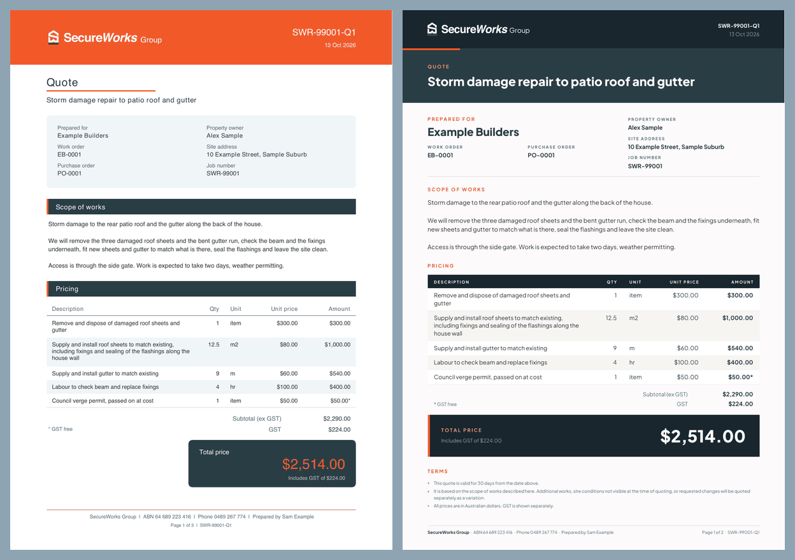
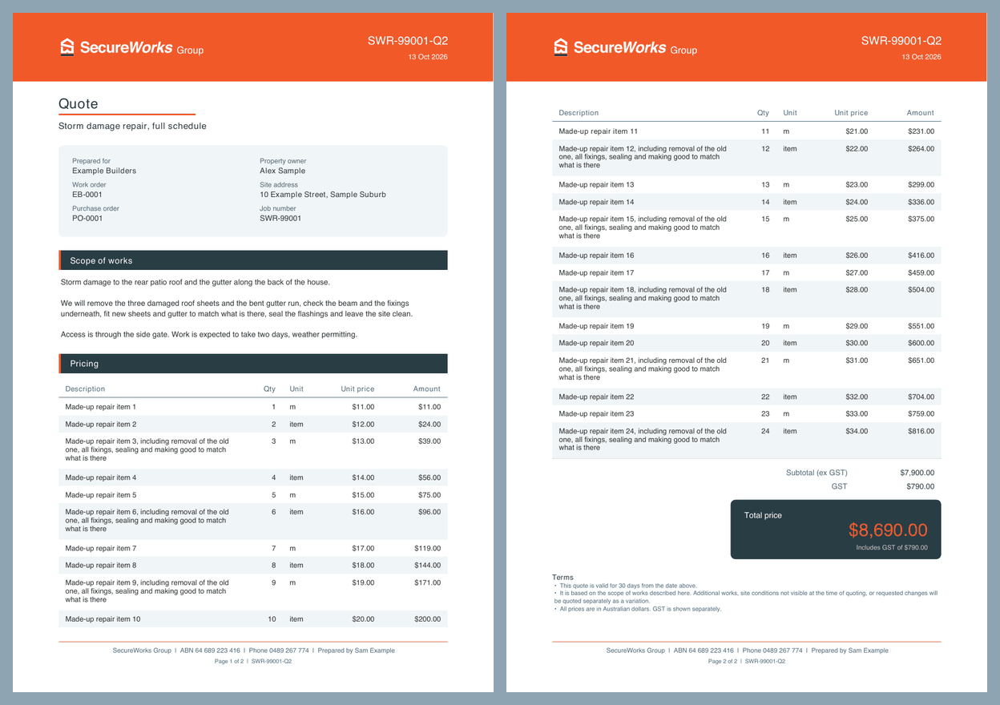
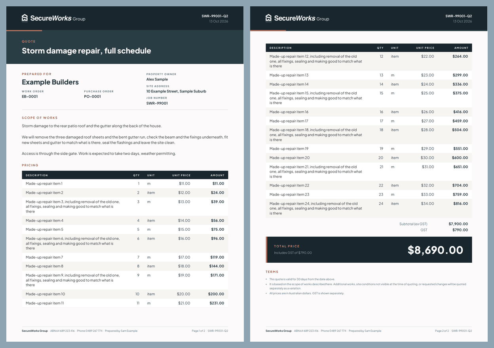
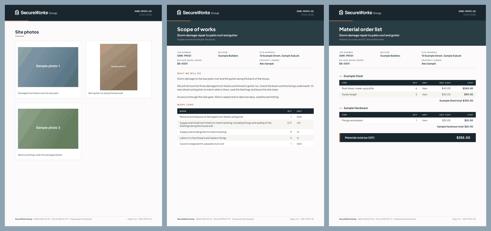

# Quote template

The client quote PDF follows the quote template the fence and patio tools share: navy top band with the white logo and an orange edge tick, Plus Jakarta Sans, warm paper ground, small orange capital labels, sharp corners, a navy table head, a navy total block with an orange stripe.

- Source of the look: fence-designer `index.html`, `_swFenceQuoteCSS` ("PREMIUM FENCING QUOTE TEMPLATE"), which is a port of the patio quote in patio `index.html` ("PREMIUM QUOTE TEMPLATE"). Fence and patio are one look, not two.
- Here it is drawn in `js/pdf.js` as real text with jsPDF, not as a picture of an HTML page, so the file stays small and the tests can read its words.
- The scope of works and the material order list use the same band, type, table and footer. Their content rules are unchanged.

## Stills (a made-up quote, `tests/e2e/pdf-fixture.js`)

| | |
|---|---|
| Page 1, before and after |  |
| A two-page quote, before |  |
| A two-page quote, after |  |
| Site photos, scope of works, material order list, after |  |

To make them again: `npm test` saves the PDFs in `test-results/shots` (`*-template-quote.pdf`, `*-template-two-page.pdf`), and `pdftoppm -png` turns a PDF into pictures.

## What the template has that this quote leaves out

The quote builder holds no data for these, so they are not printed and nothing is made up for them:

- The photograph behind the cover and the price page. The block under the band is plain slate.
- The design page: renders, elevations and drawings.
- The specifications panel, and the "what is included" and "what is not included" lists.
- The payment schedule, the deposit, the price-hold note and the lead time.
- The acceptance steps, the accept button and the "before we start" checklist.
- The seventeen-clause terms and conditions page. The quote keeps the three short terms it had.
- The close page: reviews, testimonials and the trust line, including any licence or insurance wording.
- The neighbour cost split.
- An email address and website in the footer. The config holds the name, ABN and phone only.

## Brand assets

- Logo: `assets/logo-white.png`, as before. The template uses an SVG logo with "Group" in the lockup; this repo does not have it, so "Group" is still drawn as text beside the mark.
- "Group" is drawn larger and brighter than the template draws it. The template sets it at about half the height of the wordmark in 60% white, which is too faint to read on the navy band. Here it is 10.5 pt in full white, so the band reads "SecureWorks Group" at a glance.
- Typeface: Plus Jakarta Sans regular, bold and extra bold in `assets/fonts`, under the SIL Open Font License (`assets/fonts/OFL.txt`). It is the Google font the fence and patio pages already load. The PDF needs the font files themselves, so they ship here. If a font file does not load, no PDF is made and the app says to try again: a quote is never previewed or issued in another typeface.
- No brand photographs were added.
